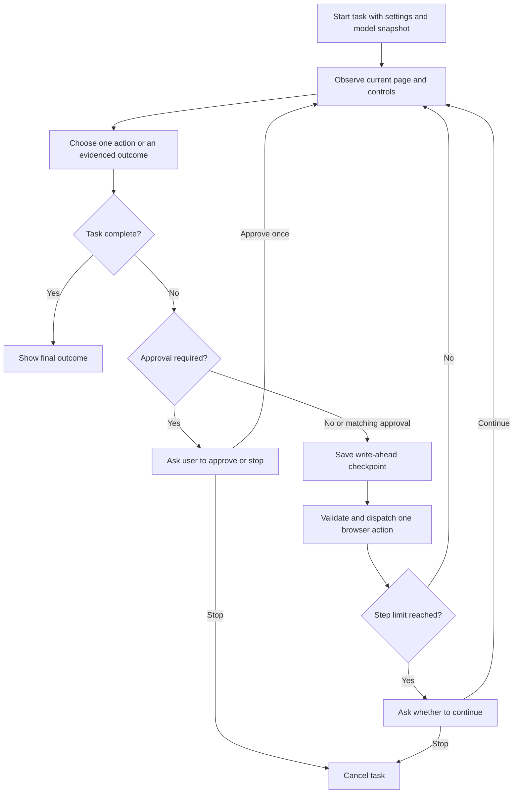

# Delight agent workflow

Updated: 2026-11-21. This describes the current source implementation; live provider and loaded-extension validation are separate from fixture tests.

## Set up chat and agents

Onboarding keeps four steps. In the last step, test and save a default chat provider/model, then answer **Use the same model for agents?**

- **Use the same model** is the default. Agents take a snapshot of the default provider configuration when a task starts.
- **Choose a different model** reveals a second provider/key/model form. Test and save that connection before Get Started is enabled. Use **Use saved provider key** to reuse a configured key for that provider, or enter another key. Ollama does not require a key.
- Each connection has its own readiness state. Editing either selected connection requires another successful test before completing onboarding. Connection errors leave onboarding blocked until corrected or the user returns to the shared-model choice.
- Change the agent choice later in **Settings → Agent**. A separate agent connection does not change the chat provider/model. Choosing the shared model clears the override. Connection tests and selected model choices save independently of the other agent settings.

Credentials are stored locally in the browser profile. The default connection uses `aiSettings`; the separate agent connection uses `agentModelConfiguration`. Neither is saved in browser sync. Provider tests and AI requests authenticate directly with the selected provider. No credentials are included in task history.

## Start and manage tasks

1. Open Agent from Delight's home/chat toolbar.
2. Choose a suggestion or type instructions. Attach the current HTTP(S) page if needed; otherwise a new background tab is created for this task.
3. Click **Run** or press Enter; Shift+Enter inserts a line.
4. Use **New** to start more tasks, and the active count or **Recent agents** to select a run. Each task has its own runtime, cancellation signal, model, and controls. Runtime tab ownership prevents two agents from controlling the same tab simultaneously.
5. Expand **Thinking** to inspect action summaries and progress messages. This is execution activity, not a raw private reasoning transcript. Final outcomes remain visible outside the collapsed area.
6. Pause/resume or stop the selected task. Returning to chat leaves tasks running in the current panel. Closing/reloading the panel interrupts its in-memory runtimes.

After restart, retained running/paused records become interrupted. Explicitly resume a saved task with a checkpoint to match its page by URL and inspect the current state. Completed actions are summarized; uncertain submissions must be verified rather than repeated. Recovery uses current settings and a fresh model instance.

## Agent settings

| Setting | Default | Behavior |
| --- | --- | --- |
| Agent model | Use default chat model | Optional separately tested provider/key/model. Running tasks retain their starting model. |
| Maximum turns | 50 | Counts attempted browser steps. At the limit, pause and ask whether to continue. Continue grants another batch of the same size. Provider retries and observations do not count as actions. |
| Custom instructions | Empty | At most 1,500 characters. Included in every new agent task and future chat request. The agent has no tool to change these instructions or credentials. |
| Confirm sensitive actions | On | Require explicit approval for recognized consequential actions and actions flagged by the planner. |
| Allowed pages | Open and switch tabs in this window | Alternatively restrict the agent to the starting tab, including navigation within it. |
| Saved task history | 20 inactive tasks | Keep 0, 10, 20, 50, or 100 inactive records. Active and paused runs retain checkpoints while the panel is open. Reducing the limit prunes older inactive records; choosing zero also removes interrupted tasks after restart. |
| Clear saved task history | User action | Delete inactive records; preserve running and paused tasks. |

Click **Save agent settings** to apply task controls to new tasks and instructions to future chat messages. History retention changes apply immediately when saved. These controls are stored in local `agentSettings`.

### Sensitive action approval

The runtime recognizes form-submit controls, Enter outside a textarea, consequential labels/descriptions (such as sending, buying, paying, publishing, or deleting), and planner actions marked `requiresConfirmation`. It shows the proposed action and **Approve action** / **Stop** controls. Ordinary Resume cannot bypass this wait.

Approval grants one matching action. The runtime observes and plans again before dispatch. If the page or proposed action changes, it asks again. Stop aborts the approval wait without dispatching. Approved actions still require observed outcome verification; approval is not proof of submission or delivery. Recognition uses heuristics and model classification and can miss sensitive actions: it is not a sandbox or a complete transaction authorization system.

### Page boundaries

Starting-tab mode hides other tab summaries, rejects explicit new/switch-tab actions and known links targeting another tab, and does not follow created tabs. It permits navigation to other URLs in the starting tab; it is a tab boundary, not a domain allowlist. Websites may still open their own popups. Browser-tabs mode is scoped to the task's browser window and still enforces runtime ownership of controlled tabs.

## Observe, decide, act, verify

The planner emits one structured action using indexes from the latest observation, rather than a fixed full plan. `ObservedBrowser` validates targets and frame routing, executes DOM or native input, and re-observes. Frames, stale controls, repeated no-progress actions, action failures, provider cooldowns, and uncertain submissions have bounded handling. Completion requires evidence. Google results, Gmail Sent, and YouTube playback have additional site-specific verification rules.

## Implementation map

- [AgentPage](../src/components/Agent/AgentPage.tsx): suggestions, attachments, run selection, approval, continuation, and collapsed activity.
- [OnboardingModelSetup](../src/components/Settings/OnboardingModelSetup.tsx), [AgentModelSettings](../src/components/Settings/AgentModelSettings.tsx), and [ProviderSetupForm](../src/components/Settings/ProviderSetupForm.tsx): shared/separate connections and tested readiness.
- [AgentSettings](../src/services/config/AgentSettings.ts) and [AgentModel](../src/services/config/AgentModel.ts): local preferences and separate agent credentials.
- [PlannerAgent](../src/services/agents/PlannerAgent.ts) and [CreateProvider](../src/services/ai/CreateProvider.ts): per-task provider instance, structured decisions, custom instructions, and untrusted page observations.
- [AgentOrchestrator](../src/services/agents/AgentOrchestrator.ts) and [ActionApproval](../src/services/agents/ActionApproval.ts): task loop, cancellation, approval, continuation, and recovery.
- [ObservedBrowser](../src/services/automation/ObservedBrowser.ts): page policy, tab ownership, DOM/frame/native input, and outcome observations.
- [AgentHistory](../src/services/agents/AgentHistory.ts): local summaries, checkpoints, retention, restart interruption, and protected active records.
- [AIService](../src/services/ai/AIService.ts): custom instructions for normal chat. Separate agent model selection does not change this service's chat provider.

## Data and verification boundaries

Tasks, custom instructions, tab URLs/titles, visible page/frame/control content, and recent outcomes are sent to the agent provider. Local history stores bounded task/action summaries, events, outcomes, and checkpoint metadata, not DOM snapshots, typed action payloads, or provider keys. Task text and summaries may still contain information the user or model includes; review pages before sharing them.

Automated tests cover storage, model routing, approvals, tab restrictions, history retention, cancellation, and continuation. Chromium fixtures adapt extension APIs and mock provider responses to check onboarding and settings. These checks do not prove a loaded extension can perform a real provider-driven task, submit a real transaction, deliver a message, or recover every website flow. Validate those separately on controlled sites before release.
